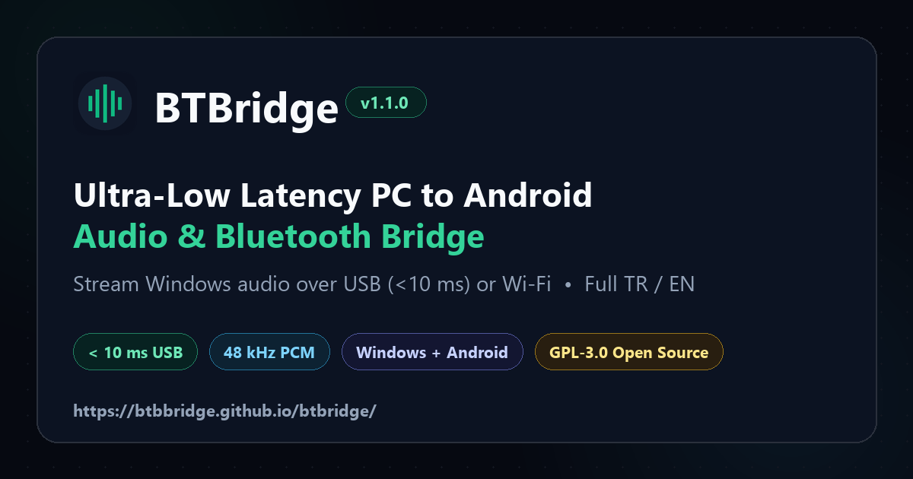

  

  
  
  
  
  

  <strong><a href="#english">English</a></strong> &nbsp;|&nbsp; <strong><a href="#türkçe">Türkçe</a></strong> &nbsp;|&nbsp; <a href="https://btbbridge.github.io/btbridge/">🌐 Official Website / Resmi Web Sitesi</a>

---

## BTBridge — Windows PC to Android Ultra-Low Latency Audio Bridge (v1.1.0)

**BTBridge** streams Windows system audio to your Android phone and connected Bluetooth headphones with near-zero latency — even when your PC has no Bluetooth adapter.

- **Website & Setup Guide:** https://btbbridge.github.io/btbridge/
- **Latest Releases (Windows Setup + Portable EXE + Android APK):** https://github.com/BtbBridge/btbridge/releases/latest

### Key Features

- **USB Mode (`< 10 ms` Latency):** Lossless `48 kHz / 16-bit` stereo PCM (`1536 kbps`) over `127.0.0.1:50005` via ADB Reverse and `TCP_NODELAY`.
- **Local Wi-Fi Mode:** `4:1` IMA-ADPCM compression with UDP Forward Error Correction (FEC) to prevent dropouts over wireless networks.
- **Smart Audio Routing (`route_silent`):** Keeps your Windows volume mixer intact while silently routing PC speakers/wired headphones to a virtual sink (VB-Cable, Voicemeeter) or HDMI/Monitor sink, and automatically restores your original device on stop.
- **Full Bilingual Experience (TR / EN):** Language selector in the Windows Installer (`BTBridge_Setup.exe`), Windows desktop app + tray menu, Android app (first-launch prompt + header toggle), and website.
- **No External Runtimes Needed:** Bundled ADB platform-tools and `BTBridge.apk` inside the Windows installer.

### Download v1.1.0

| File | Platform | Size | SHA-256 |
| :--- | :--- | :--- | :--- |
| `BTBridge_Setup.exe` | Windows 10/11 (64-bit) Installer | `54.6 MB` | `1890F2456123E9A592EE601922916F2F066A92B525183DBBFF4866C4B7547B6C` |
| `BTBridge.exe` | Windows 10/11 Portable Single EXE | `35.1 MB` | `614F73D36B50061F855FCE78CF004664557B7E6017835E7F1E25B7D18193FE5F` |
| `BTBridge.apk` | Android 8.0+ (API 26+) Client | `15.6 MB` | `DE7CF62F244BA75555C5FD3C119C903BB2DA015C215691218A69B12E4CE7E5FD` |

### Project Structure

- `pc-server/` — WASAPI Loopback audio capture (`PyAudioWPatch`), TCP/UDP streaming server, Windows Core Audio routing, bilingual CustomTkinter UI & system tray
- `android-client/` — Kotlin + Jetpack Compose app, Low-Latency `AudioTrack`, adaptive `JitterBuffer`, Bluetooth A2DP monitor, Foreground Service
- `installer/` — Multilingual Inno Setup installer (`BTBridge.iss`)
- `protocol/` — Binary framing and control protocol specification (`PROTOCOL.md`)
- `website/` — Bilingual landing and download page deployed via GitHub Pages

### Contact & Support

- **Discord:** `.vor_tex13.`
- **GitHub Issues:** [BtbBridge/btbridge/issues](https://github.com/BtbBridge/btbridge/issues)

---

## BTBridge — Windows PC'den Android'e Ultra Düşük Gecikmeli Ses Köprüsü (v1.1.0)

**BTBridge**, bilgisayarınızda Bluetooth donanımı olmasa bile Windows sistem sesini USB kablo (ADB Reverse) veya Yerel Wi-Fi üzerinden Android telefonunuza ve telefonunuza bağlı Bluetooth kulaklığınıza sıfıra yakın gecikmeyle aktaran açık kaynaklı ses köprüsüdür.

- **Resmi Web Sitesi & Kurulum Rehberi:** https://btbbridge.github.io/btbridge/
- **Son Sürüm İndirmeleri (v1.1.0):** https://github.com/BtbBridge/btbridge/releases/latest

### Öne Çıkan Özellikler

- **USB (ADB Reverse) Modu (`< 10 ms`):** `127.0.0.1:50005` üzerinden `TCP_NODELAY` ile kayıpsız `48 kHz / 16-bit` stereo PCM akışı (`1536 kbps`).
- **Yerel Wi-Fi Modu:** Kablosuz bağlantıda `4:1` IMA-ADPCM sıkıştırma ve paket kaybını telafi eden UDP FEC kurtarma mekanizması.
- **Akıllı Ses Yönlendirme (`route_silent`):** Yayın sırasında PC hoparlörü veya kablolu kulaklığınızdan çift ses çıkmasını önlemek için sistem ses düzeyinizi bozmadan akışı sanal sürücüye (VB-Cable vb.) veya HDMI/Monitör çıkışına taşır; yayın durduğunda önceki çıkışa otomatik döner.
- **Tam Çift Dil Desteği (TR / EN):** Windows kurulum sihirbazı, PC uygulaması + sistem tepsisi, Android uygulaması (ilk açılış dil seçimi + başlık çubuğu geçişi) ve web sitesi Türkçe / İngilizce desteklidir.
- **Kurulum Kolaylığı:** Python veya JDK kurulumu gerektirmez; `BTBridge_Setup.exe` içinde ADB araçları ve `BTBridge.apk` gömülüdür.

### İletişim & Destek

- **Discord:** `.vor_tex13.`
- **GitHub Issues:** [BtbBridge/btbridge/issues](https://github.com/BtbBridge/btbridge/issues)

### License / Lisans

Licensed under the [GNU General Public License v3.0 (GPL-3.0)](LICENSE).
